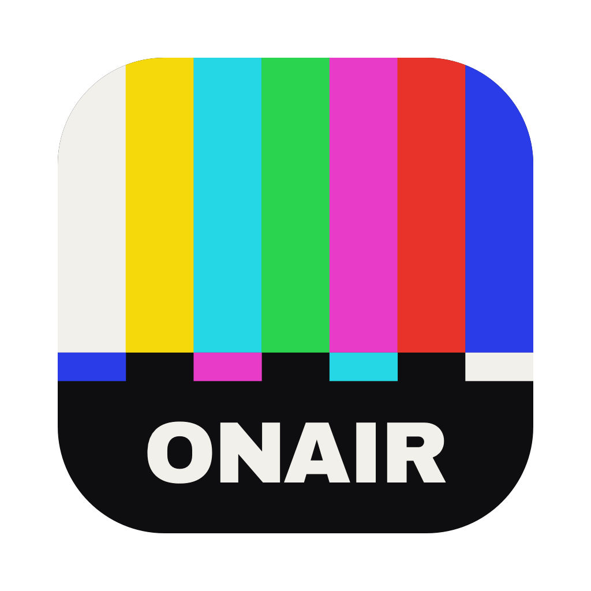

# ONAIR



**Just TV.** No ads. No watermarks. No accounts. No tracking.
**Free and open source. Built like it isn't.**

Free software shouldn't look or feel worse than paid software. ONAIR is built to the same standard as the best paid apps on the Mac, and the code is open so anyone can check every promise. See [docs/BRAND.md](docs/BRAND.md).

ONAIR is an IPTV player for macOS, written in SwiftUI. Add an M3U playlist (a link or a file) or an Xtream Codes account. Channels are numbered like a tuner, and each one shows what's on now. Zap with the arrow keys and press Return for full screen.

ONAIR ships with no channels. Use only playlists you're entitled to.

### Free lists

The add sheet has a **Free** tab with one-click public playlists from [iptv-org](https://github.com/iptv-org/iptv) and [Free-TV/IPTV](https://github.com/Free-TV/IPTV). Both projects only list streams that are free and public: Portugal, Portuguese-language, Free-TV, News, Sports, Movies, Music, Kids, Documentary, and all of iptv-org (over 11,000 channels). They're community lists, so some channels are offline or geo-blocked at any given time, and they carry no programme guide. Edit `Sources/OnAir/FreeLists.swift` to change them.

Know another free, legal list? [Suggest it](https://github.com/jorgesousa/onair/issues/new?title=Free%20list%3A%20&labels=free-list) — there's a link to the same form in the app.

## Install

From source (macOS 14+, Xcode):

```bash
scripts/build-app.sh --install
```

With Homebrew, once the tap is published: `brew install jorgesousa/tap/onair`.

## Updates

When a new release is out, an UPDATE tag appears at the bottom of the channel list and in About ONAIR, with the command to run: `brew update && brew upgrade onair` (or `git pull && scripts/build-app.sh --install` from source). Releases are GitHub releases tagged `vX.Y.Z`, matching `CFBundleShortVersionString` in `Support/Info.plist`.

## Keys

| Key | Does |
|---|---|
| ↑ ↓ | Previous / next channel (list focused) |
| ⌘↑ ⌘↓ | Previous / next channel, anywhere |
| Return | Full screen |
| ⌘R | Reload playlist |

## How it works

- Per-stream `http-user-agent` / `http-referrer` hints in a list (and `#EXTVLCOPT`) are sent with the stream; some channels need them.
- `get.php?username=…&password=…` M3U links are read as Xtream accounts, which unlocks the guide.
- The guide is the account's XMLTV, downloaded once and refreshed every 3 hours. It is not fetched per channel.
- Playback is AVFoundation, so streams must be HLS. Raw MPEG-TS links are asked for as `/live/…/<id>.m3u8`, which Xtream servers serve.
- Most accounts allow one connection. Switching closes the old stream first and retries a refused one before giving up.
- Passwords are stored in the Keychain. Everything else is stored in the app's preferences.
- ONAIR talks to your provider and, once a day, asks GitHub for the latest release number. That request carries nothing about you. Turn it off in About ONAIR → "Check for updates automatically".
- Films and series are built but hidden (`ContentView.showsLibraries`).

## Testing

Put a test account in `.test-account` (ignored by Git) with `SERVER`, `USERNAME` and `PASSWORD`, then run `scripts/smoke-test.sh`.

## Credits

By Jorge Sousa. Type: Archivo Black (SIL OFL). MIT licence.
