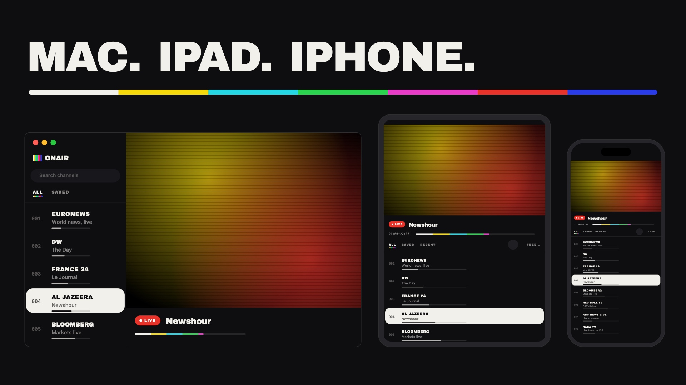

# ONAIR


**Just TV.** No ads. No watermarks. No accounts. No tracking.
**Free and open source. Built like it isn't.**

Free software shouldn't look or feel worse than paid software. ONAIR is built to the same standard as the best paid apps, and the code is open so anyone can check every promise. See [docs/BRAND.md](docs/BRAND.md).

ONAIR plays your TV on the Mac, the iPad and the iPhone. Bring the IPTV subscription you already have, or start with free public channels. Channels are numbered like a tuner and each one shows what's on now, so changing channel feels like a real TV, not like browsing a website.

ONAIR ships with no channels. Use only playlists you're entitled to.

## What it's like

- **Zap like a real TV.** Arrow keys on the Mac, a swipe on the iPad and iPhone.
- **See what's on now** and what's next, on every channel.
- **The same app everywhere.** Same lists, same look on the Mac, the iPad and the iPhone. Turn the iPhone sideways and the picture fills the screen.
- **One TV, several screens.** With [Dispatcharr](https://github.com/Dispatcharr/Dispatcharr) at home, a one-connection subscription plays on every screen in the house (one channel at a time), and changing the channel on your phone changes it everywhere. [How it works and how to set it up](docs/DISPATCHARR.md).
- **Free channels in one click.** Public playlists from [iptv-org](https://github.com/iptv-org/iptv) and [Free-TV](https://github.com/Free-TV/IPTV), over 11,000 channels. Know another free, legal list? [Suggest it](https://github.com/jorgesousa/onair/issues/new?title=Free%20list%3A%20&labels=free-list).
- **It tells you the truth.** A channel that isn't broadcasting says OFF AIR instead of spinning forever.

<a href="https://github.com/jorgesousa/onair/raw/main/docs/onair.mp4">
  
</a>

▶ <a href="https://github.com/jorgesousa/onair/raw/main/docs/onair.mp4">Watch the 23-second video (with sound)</a>

## Get it

**Mac** (macOS 14+), from source with Xcode installed:

```bash
scripts/build-app.sh --install
```

With Homebrew, once the tap is published: `brew install jorgesousa/tap/onair`.

**iPad and iPhone** (iOS 17+): open `iPad/OnAir.xcodeproj` in Xcode, pick your device and press Run. It isn't on the App Store yet.

## Updates

On the Mac, when a new version is out, an UPDATE tag appears at the bottom of the channel list. Press **Update now** and ONAIR updates itself and restarts. Your lists, saved channels and passwords are kept.

## Keys

| Key | Does |
|---|---|
| ↑ ↓ | Previous / next channel (list focused) |
| ⌘↑ ⌘↓ | Previous / next channel, anywhere |
| Return | Full screen |
| ⌘R | Reload playlist |

## For developers

How playback, providers, the guide and updates work, plus releasing and testing: [docs/HOW-IT-WORKS.md](docs/HOW-IT-WORKS.md). The Dispatcharr side, with diagrams: [docs/DISPATCHARR.md](docs/DISPATCHARR.md).

## Credits

By Jorge Sousa. Type: Archivo Black (SIL OFL). MIT licence.
