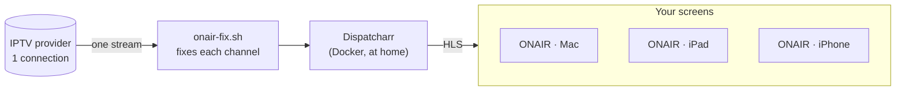
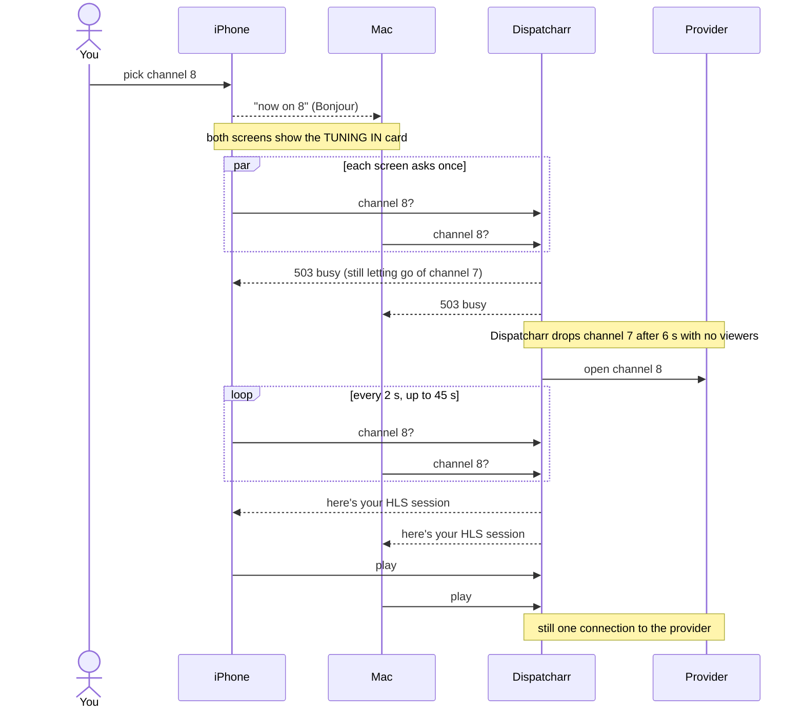
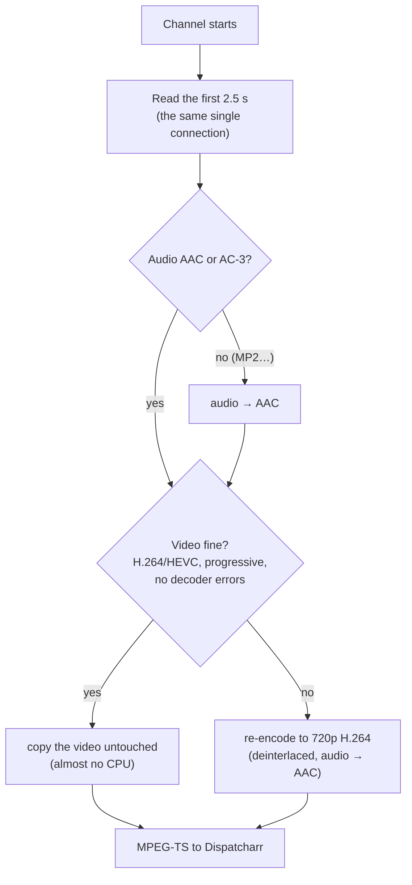
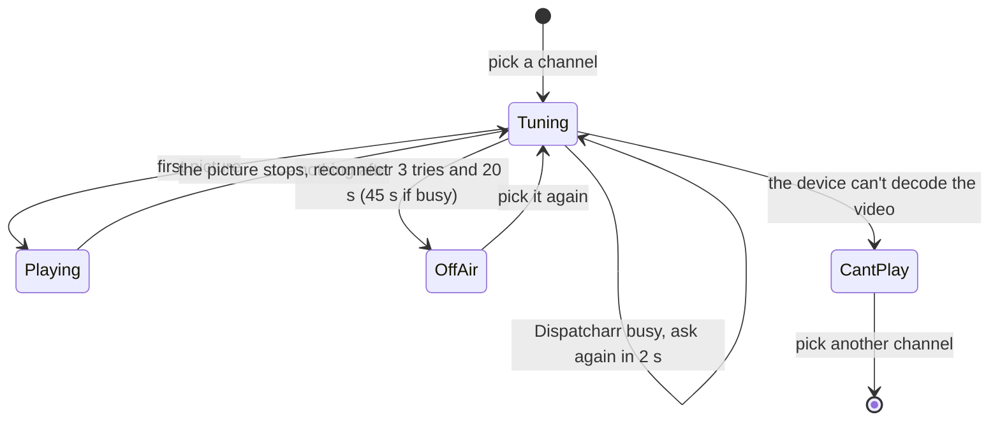

# One TV, several screens (with Dispatcharr)

Most IPTV subscriptions allow **one connection at a time**. Open a second screen and the provider refuses it, or drops the first. ONAIR on its own can't change that: every Mac, iPad and iPhone talks to the provider directly.

[Dispatcharr](https://github.com/Dispatcharr/Dispatcharr) fixes it. It's a small server you run at home that holds the one connection to the provider and hands the picture to every screen in the house. ONAIR knows how to work with it:

- **Several screens, one connection.** Any number of screens can watch the same channel and the provider still counts one.
- **The screens follow each other.** Change the channel on the iPhone and the Mac and the iPad change too.
- **Channels that didn't play now do.** A small script fixes, per channel, the video and audio Apple's players reject.
- **Programme guide included.** What's on now and next, from the provider's guide.

One connection still means **one channel at a time** for the whole house.

## How it fits together



- Dispatcharr reads the stream from the provider **once** and serves it to every screen as HLS, the format Apple's players play.
- The ONAIR apps find each other on the local network (Bonjour, `_onair._tcp`). Whoever changes channel tells the others, and they follow. Whoever opens the playlist later joins what's already on.
- Only playlists that come from Dispatcharr (its `/output/m3u` link) follow each other. Your other playlists stay independent.

## Changing channel



- **ONAIR asks once, then plays.** It asks Dispatcharr for the channel's HLS session, reads where it lives and hands that to the player. Letting the player ask on its own made it open several requests at once, which Dispatcharr counted as extra viewers and cut off.
- **Busy isn't broken.** While Dispatcharr is still letting go of the old channel it answers "busy" (503). ONAIR keeps the TUNING IN card up and asks again every 2 seconds, for up to 45 seconds, instead of showing an error.
- **Joining a channel that's already on is instant**, about 0.2 s to the session and a picture within the first second. A channel nobody is watching takes 8 to 10 seconds to start, the time Dispatcharr needs to open it and cut the first segments.

## Fixing channels that don't play

Some channels play with sound but no picture, or don't play at all, on Apple devices. The two causes we found on a real Portuguese line-up of 268 channels:

- **Video Apple's decoder refuses.** H.264 that uses more reference frames than its level allows (most "Full HD" channels, which are also interlaced). Other players ignore it; Apple's decoder drops the picture.
- **Audio the iPhone refuses.** MP2 audio inside HLS plays on the Mac but not on the iPhone or iPad.

[`scripts/dispatcharr/onair-fix.sh`](../scripts/dispatcharr/onair-fix.sh) is a Dispatcharr stream profile that looks at each channel when it starts and does only what that channel needs:



On that line-up: 111 channels played as they were, 9 needed only the audio fixed, 65 the video, 41 both, and 42 weren't broadcasting at the time of the scan. Re-encoding costs about half a CPU core per channel being watched. Passing through costs almost nothing.

## What you see on screen



- **TUNING IN**: the test card with the channel's name, until the first picture.
- **OFF AIR**: the channel isn't sending anything. Picking it again tries again, since channels do come back.
- **CAN'T PLAY**: the video is in a format this device can't show. With the fix script in place this should be rare.

## Setting it up

You need a computer that's always on at home (a Mac, a NAS, a Raspberry Pi 4 or better) with Docker.

1. **Run Dispatcharr**, with a folder for the ONAIR script:

   ```bash
   mkdir -p ~/dispatcharr && cp scripts/dispatcharr/onair-fix.sh ~/dispatcharr/
   docker run -d --name dispatcharr --restart unless-stopped -p 9191:9191 \
     -v dispatcharr_data:/data -v ~/dispatcharr:/onair \
     ghcr.io/dispatcharr/dispatcharr:latest
   ```

   On a Mac without Docker Desktop, [Colima](https://github.com/abiosoft/colima) works.

2. **Add your provider** in Dispatcharr (http://&lt;server&gt;:9191) as an M3U account with **Max streams 1**, and pick the channel groups you want.

3. **Add the fix as a stream profile** and make it the default: command `/onair/onair-fix.sh`, parameters `{userAgent} {streamUrl}`.

4. **Add the guide**: an EPG source with your provider's XMLTV, then match channels by their exact `tvg-id`. Matching by name pairs the wrong channels (SIC Novelas with SIC Notícias, for example).

5. **Faster channel changes** (optional, recommended): in Dispatcharr's `apps/proxy/config.py`, set `CLIENT_RECORD_TTL = 6` (default 60: how long a channel nobody watches keeps the connection) and `HLS_SEGMENT_DURATION = 2` (default 4: a quicker start). Mount your edited copy over the original with `-v ~/dispatcharr/config.py:/app/apps/proxy/config.py:ro`.

6. **In ONAIR**, on every device, add an M3U playlist with
   `http://<server>:9191/output/m3u?output_format=hls`.
   The iPhone and iPad will ask to see devices on your local network: allow it, that's how the screens follow each other.

## Limits

- **One channel at a time.** Two screens on different channels need two connections. The second one waits (TUNING IN) until the first lets go.
- **Re-encoded channels are 720p.** Enough for a phone and a tablet, softer on a big TV.
- **New channels need matching to the guide.** When the provider adds channels, match them by `tvg-id` again.
